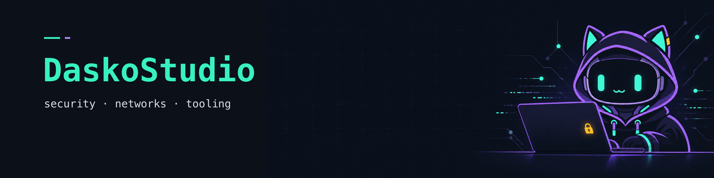

<div align="center">




[](https://github.com/DaskoStudio)


</div>

```text
$ whoami
konate-adama

$ cat focus.txt
security tooling · network administration · smart contract auditing
```

## Projects

| | |
|---|---|
| 🧰 [**cyber-workbench**](https://github.com/DaskoStudio/cyber-workbench) | Modular cybersecurity platform — OSINT, network, crypto. *(showcase: architecture only)* |
| 🤖 [**alfred-agentic-os**](https://github.com/DaskoStudio/alfred-agentic-os) | Agentic OS, multi-agent orchestration through an MCP registry. *(showcase)* |
| 🔍 [**smartcontract-audit-demo**](https://github.com/DaskoStudio/smartcontract-audit-demo) | Reentrancy & `tx.origin`: vulnerable contract, fix, Foundry tests. |
| 📈 [**ia-army**](https://github.com/DaskoStudio/ia-army) | Multi-agent system around Solana. *(showcase)* |
| 🎵 [**groupie-tracker**](https://github.com/DaskoStudio/groupie-tracker) | Go/Fyne desktop app on top of a REST API. |
| 📚 [**mediatheque-api**](https://github.com/DaskoStudio/mediatheque-api) | FastAPI service, ORM vs raw SQLite. |

<sub>"Showcase" repos expose the architecture only; the core stays private.</sub>

## Stack


**Security** — OSINT · smart contract auditing · detection · pentest basics
**Networks** — network administration · network analysis · Linux

## Activity

<div align="center">

[](https://github.com/DaskoStudio)
[](https://github.com/DaskoStudio)

</div>
